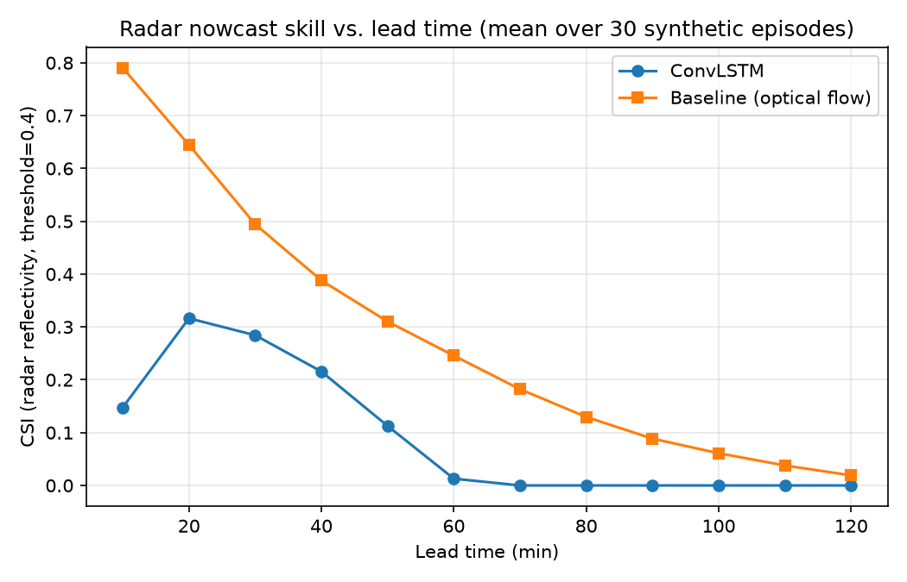

# Evaluation: ConvLSTM vs. Optical-Flow Baseline

Batch evaluation over **30 fresh synthetic episodes** (seeds 900000-900029, not seen during training), comparing the trained ConvLSTM nowcast model against the classical optical-flow extrapolation baseline (`nowcast_cpp` / OpenCV fallback — see `docs/design.md` section 2.2).

Generated by `scripts/evaluate.py`. Reproduce with:
```
cd backend && ../.venv/Scripts/python ../scripts/evaluate.py
```

## Radar reflectivity nowcast (threshold=0.4)



### CSI (Critical Success Index)
| Lead time (min) | ConvLSTM | Baseline (optical flow) |
|---|---|---|
| 10 | 0.148 | 0.790 |
| 20 | 0.316 | 0.645 |
| 30 | 0.284 | 0.494 |
| 40 | 0.216 | 0.388 |
| 50 | 0.113 | 0.310 |
| 60 | 0.013 | 0.246 |
| 70 | 0.000 | 0.182 |
| 80 | 0.000 | 0.130 |
| 90 | 0.000 | 0.089 |
| 100 | 0.000 | 0.061 |
| 110 | 0.000 | 0.038 |
| 120 | 0.000 | 0.019 |

### POD (Probability of Detection)
| Lead time (min) | ConvLSTM | Baseline (optical flow) |
|---|---|---|
| 10 | 0.154 | 0.875 |
| 20 | 0.400 | 0.845 |
| 30 | 0.386 | 0.786 |
| 40 | 0.282 | 0.706 |
| 50 | 0.141 | 0.699 |
| 60 | 0.019 | 0.655 |
| 70 | 0.000 | 0.565 |
| 80 | 0.000 | 0.495 |
| 90 | 0.000 | 0.449 |
| 100 | 0.000 | 0.402 |
| 110 | 0.000 | 0.267 |
| 120 | 0.000 | 0.211 |

### FAR (False Alarm Ratio)
| Lead time (min) | ConvLSTM | Baseline (optical flow) |
|---|---|---|
| 10 | 0.072 | 0.127 |
| 20 | 0.269 | 0.254 |
| 30 | 0.386 | 0.402 |
| 40 | 0.480 | 0.515 |
| 50 | 0.553 | 0.598 |
| 60 | 0.359 | 0.666 |
| 70 | 0.000 | 0.732 |
| 80 | 0.000 | 0.790 |
| 90 | 0.000 | 0.835 |
| 100 | 0.000 | 0.866 |
| 110 | 0.000 | 0.892 |
| 120 | 0.000 | 0.913 |

### HSS (Heidke Skill Score)
| Lead time (min) | ConvLSTM | Baseline (optical flow) |
|---|---|---|
| 10 | 0.212 | 0.844 |
| 20 | 0.439 | 0.738 |
| 30 | 0.396 | 0.606 |
| 40 | 0.307 | 0.498 |
| 50 | 0.164 | 0.416 |
| 60 | 0.018 | 0.340 |
| 70 | 0.000 | 0.259 |
| 80 | 0.000 | 0.186 |
| 90 | 0.000 | 0.128 |
| 100 | 0.000 | 0.086 |
| 110 | 0.000 | 0.049 |
| 120 | 0.000 | 0.018 |

## Lightning occurrence nowcast (threshold=0.5 probability, ground truth threshold=0.15)

### CSI
| Lead time (min) | ConvLSTM | Baseline (optical flow) |
|---|---|---|
| 10 | 0.000 | 0.129 |
| 20 | 0.000 | 0.081 |
| 30 | 0.000 | 0.043 |
| 40 | 0.000 | 0.028 |
| 50 | 0.000 | 0.014 |
| 60 | 0.000 | 0.006 |
| 70 | 0.000 | 0.001 |
| 80 | 0.000 | 0.000 |
| 90 | 0.000 | 0.000 |
| 100 | 0.000 | 0.000 |
| 110 | 0.000 | 0.000 |
| 120 | 0.000 | 0.000 |

### POD
| Lead time (min) | ConvLSTM | Baseline (optical flow) |
|---|---|---|
| 10 | 0.000 | 0.174 |
| 20 | 0.000 | 0.123 |
| 30 | 0.000 | 0.064 |
| 40 | 0.000 | 0.042 |
| 50 | 0.000 | 0.022 |
| 60 | 0.000 | 0.011 |
| 70 | 0.000 | 0.001 |
| 80 | 0.000 | 0.000 |
| 90 | 0.000 | 0.000 |
| 100 | 0.000 | 0.000 |
| 110 | 0.000 | 0.000 |
| 120 | 0.000 | 0.000 |

## Interpretation

The picture is mixed with this lightly-trained checkpoint (3 epochs on ~64 synthetic episodes): ConvLSTM mean CSI is 0.091 vs baseline 0.283 on the radar field, and 0.000 vs 0.025 on lightning occurrence. It wins on radar CSI at 0/12 lead times and on lightning CSI at 0/12 lead times — this is an honest result for a proof-of-concept checkpoint, not a fully converged model; more training data/epochs (see NEXT_STEPS.md) would be expected to widen the ConvLSTM's advantage, particularly at longer lead times where optical-flow extrapolation is known to degrade faster than a learned model (see docs/research_notes.md).

This evaluation is run against the synthetic generator's own known future (replay verification — see `backend/app/core/state.py` docstring), the same principle used to verify nowcasts against observed future radar in real operations. As documented throughout `docs/design.md` and `docs/research_notes.md`, this is a proxy-data evaluation (no dataset was issued with SIH PS 26072) meant to validate the architecture and pipeline, not to claim operational skill scores on real Indian storms.
